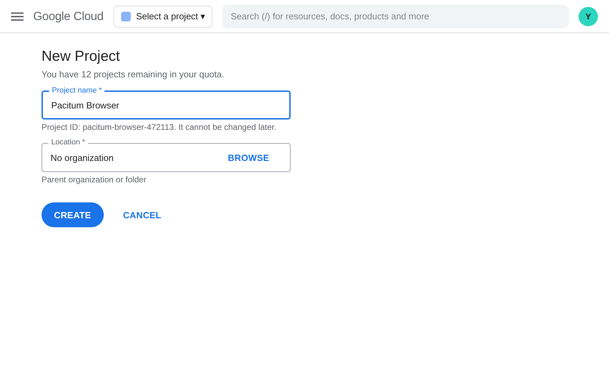
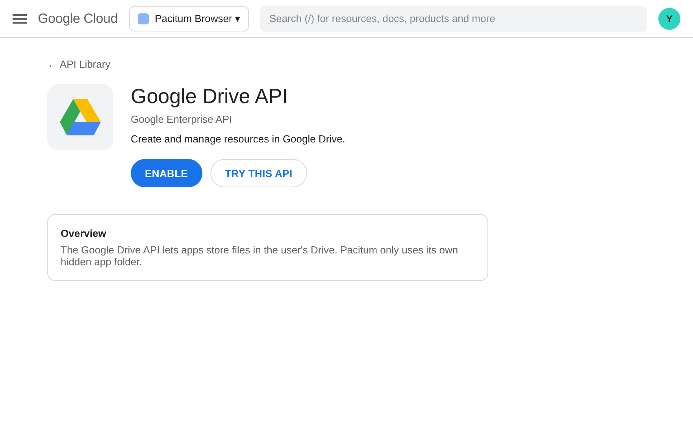
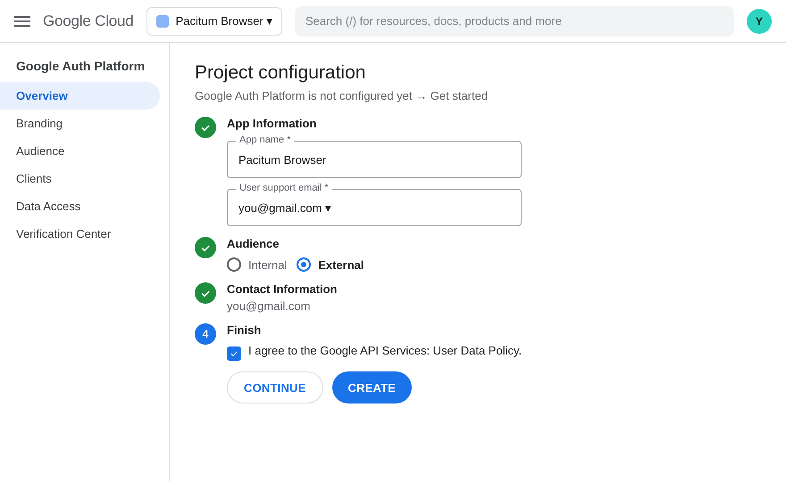
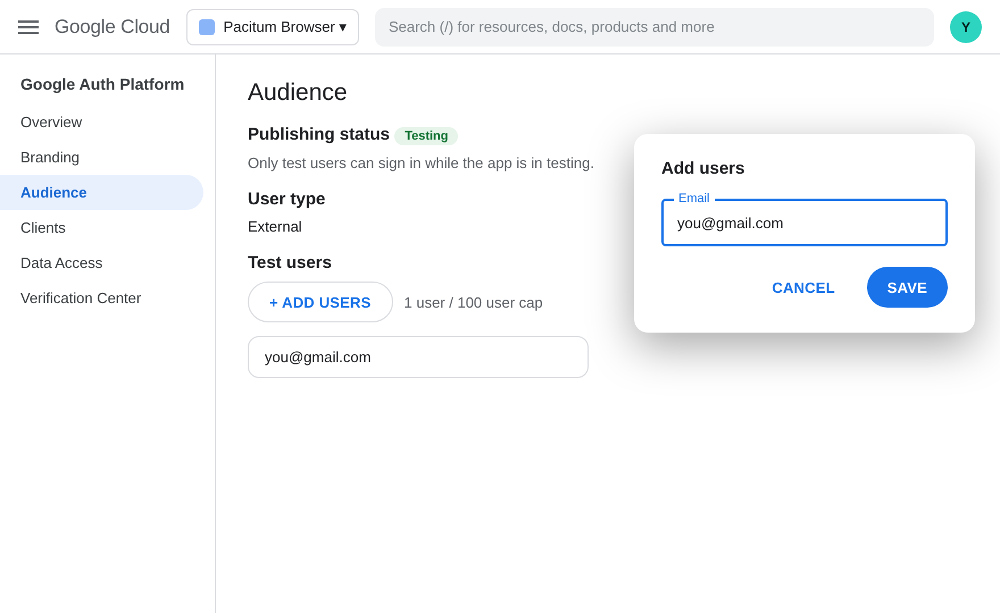
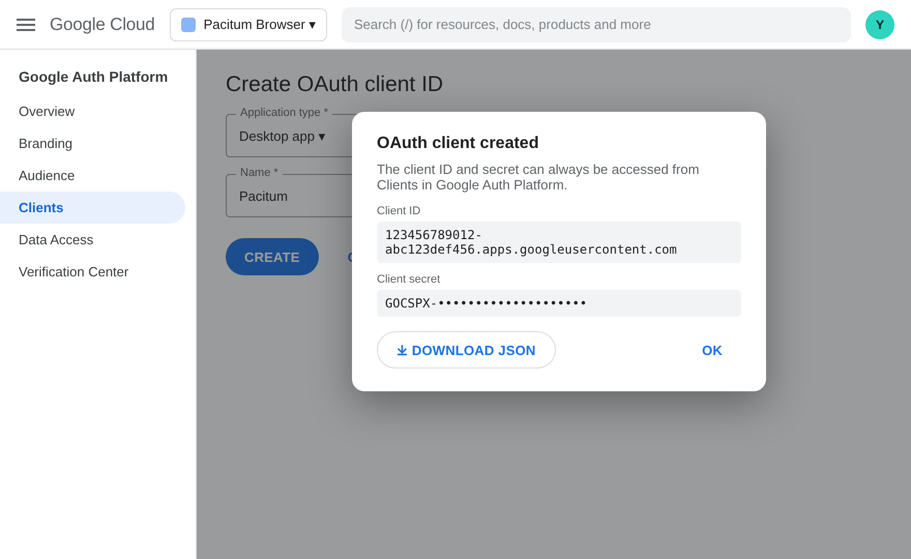
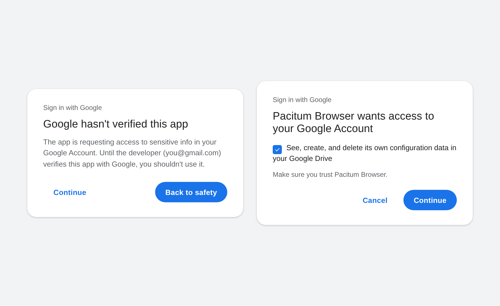

# Google sync — one-time setup

Pacitum syncs bookmarks, settings, notes and recent history through **your own Google Drive**
(a hidden app-data area only Pacitum can read). To sign users in, Google needs an
**OAuth client** for the app. You create it once, for free.

**Easiest:** in Pacitum open **Settings › Sync and Google › Start the guide**. It walks through the steps below
with a picture of each page, opens the right Google Cloud page for you and reads the downloaded client file.

| | |
|---|---|
|  |  |
|  |  |
|  |  |

(Drawings of the Google pages; the real ones may look slightly different.)

## 1. Create the OAuth client (Google Cloud Console)
1. Open <https://console.cloud.google.com/> and create a project (for example *Pacitum Browser*).
2. **APIs & Services → Library** → enable **Google Drive API**.
3. **APIs & Services → OAuth consent screen** (Google Auth Platform):
   - User type **External**, app name *Pacitum Browser*, your support e-mail.
   - Scopes: `openid`, `email`, `profile`, `.../auth/drive.appdata`.
   - While the app is in **Testing**, add the Google accounts that may sign in under **Test users**
     (up to 100). Publish the app when you want anyone to sign in. Google may review `drive.appdata` first.
4. **APIs & Services → Credentials → Create credentials → OAuth client ID** → type **Desktop app**.
   Copy the **Client ID** and **Client secret**.

A desktop app's "secret" isn't really secret (it ships inside the program); Google's sign-in for desktop
apps is protected by PKCE and the loopback redirect instead. Still, keep it out of the source code.

## 2. Give it to Pacitum (pick one)
- **Release builds (recommended):** in GitHub → repository **Settings → Secrets and variables → Actions**, add
  `PACITUM_GOOGLE_CLIENT_ID` and `PACITUM_GOOGLE_CLIENT_SECRET`. The Windows, Linux and macOS workflows build them in.
- **Local build:** `cmake -B build -DPACITUM_GOOGLE_CLIENT_ID=… -DPACITUM_GOOGLE_CLIENT_SECRET=…`
- **Without rebuilding:** environment variables `PACITUM_GOOGLE_CLIENT_ID` / `PACITUM_GOOGLE_CLIENT_SECRET`,
  or paste them in **Settings → Sync and Google → Advanced**.

## How it works
- **Sign in:** Pacitum opens Google's page in your default browser and listens on `http://127.0.0.1:<random port>`
  for the answer (OAuth 2.0 for desktop apps, PKCE). The refresh token is saved in the profile folder
  (`sync-account.json`, readable only by your user account).
- **Data:** one file, `pacitum-sync.json`, in Drive's `appDataFolder`.
- **Merge:** three-way against the last synced copy (`sync-base.json`), so deleting a bookmark on one computer
  deletes it everywhere, while bookmarks added on two computers both stay. Settings: the side that changed a value
  wins; on a brand-new computer the saved Drive settings win. Notes edited on both sides are kept both.
  History only grows (newest 500 pages).
- **When:** at startup, every 15 minutes, and with **Sync now**. Each kind can be switched off.
- **Sign out** revokes the token at Google. The Drive copy stays until you remove Pacitum's access at
  <https://myaccount.google.com/permissions> (that also deletes its app data).
